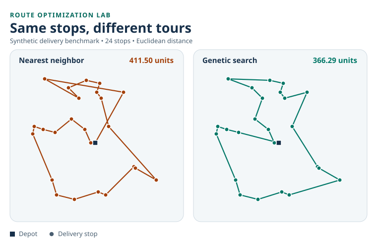

# Route Optimization Lab

Compare search strategies for a delivery vehicle that visits each stop exactly once and returns to its depot. The lab generates synthetic maps from a seed, validates every tour, and measures total distance on the same set of stops.



## Run it

Requires Python 3.10 or newer. The project uses the Python standard library.

```bash
python route_lab.py --stops 24 --seed 4 --svg demo/route-comparison.svg
python route_lab.py --stops 8 --seed 42 --exact
python -m unittest -v
```

## What the algorithms do

| Method | Strategy |
| --- | --- |
| Nearest neighbor | Repeatedly visit the closest unvisited stop. |
| Nearest neighbor + 2-opt | Start from the baseline and reverse route segments whenever doing so shortens the tour. |
| Genetic search | Seed one candidate with the baseline, combine route segments from selected parents, mutate by reversal, and carry the best candidate forward. |
| Exact search | Check every possible order on maps with up to eight delivery stops and report the optimum. |

## Reproducible results

The 24-stop example uses seed 4. Distances include the return to the depot.

| Method | Distance (units) | Change vs. baseline |
| --- | ---: | ---: |
| Nearest neighbor | 411.50 | — |
| Nearest neighbor + 2-opt | 372.99 | −9.36% |
| Genetic search | 366.29 | −10.99% |

On the 24-stop map with seed 3, 2-opt found a shorter tour than genetic search, 364.80 versus 379.73 units. On the eight-stop map with seed 42, both reached the exact optimum of 175.13 units. These examples illustrate why comparing algorithms on several maps matters.

## Assumptions and next experiment

Distances are straight-line and symmetric. The benchmark models one vehicle and leaves out travel times, road networks, and delivery time windows. The genetic search uses 80 candidates and 120 generations, so the comparison covers solution distance under one set of search parameters.

A follow-up experiment is to measure the median distance and running time over 30 seeds, then compare the heuristics against exact search on small maps.

## Project status

This is a new portfolio learning project prepared with AI assistance. The data is generated by the program.
